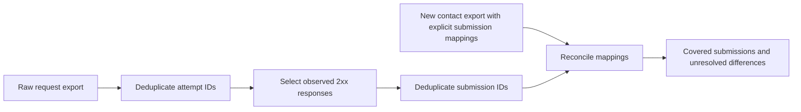

Akshay Shaligram — https://growth-marketing-consultant.com/

I built this small measurement lab to make one common reporting problem inspectable: form requests, successful submissions and newly created CRM contacts are different counts. The code runs locally, uses no dependencies or credentials, and includes synthetic examples and tests. Developed with AI assistance; no client results or production records are included.

# Growth measurement lab

## Run it

Node.js 20 or newer; no installation step or API account required.

```sh
node demo.mjs
node --test
```

The example returns **100 unique attempts → 82 successful responses → 75 distinct successful submission IDs → 69 matched new CRM contacts**. Coverage is 69/75 = 92%, not 69/100. This is *new-contact coverage*, not a sales conversion rate or a delivery SLA.



## Contract

`reconcile(attempts, contacts)` accepts two arrays. Attempts use `{attemptId, submissionId, status}`. Each request/retry must have its own stable attempt ID; retries of the same logical form submission share a submission ID. Duplicate exports of a request reuse the attempt ID. Conflicting duplicates fail rather than silently selecting a winner.

Contacts use `{contactId, submissionIds}`. Supply **new contacts in the agreed reporting window**, with explicit upstream submission mappings. Duplicate rows for one contact merge their mapping sets. A contact may legitimately cover several submissions; the coverage numerator counts submissions, not contacts.

```js
import { reconcile } from './reconcile.mjs';
const report = reconcile(
  [{attemptId:'request-1',submissionId:'submission-1',status:201}],
  [{contactId:'contact-1',submissionIds:['submission-1']}]
);
console.log(report.newContactCoverage); // 1
```

## Why counts disagree

| Difference | What to investigate |
|---|---|
| Export rows exceed unique attempts | Export overlap or repeated ingestion |
| Successful attempts exceed successful submission IDs | Network retries or repeated success logging |
| Successful submissions exceed new contacts | Existing-contact updates, merge behaviour, ingestion lag, mapping errors or loss |
| A contact mapping has no observed success | Window mismatch, incomplete request export, mapping error or another intake path |

The library reports discrepancies; it does not diagnose their cause. In the synthetic example, six submissions have no *new* contact mapping. Calling all six “lost leads” would be unsupported.

## Limits and safe adaptation

- A 2xx is an observed transport/application response, not proof of durable CRM storage. Validate the response body and downstream write acknowledgement in your own adapter. For asynchronous 202 responses, provide a terminal status export instead of assuming completion.
- Choose one timezone, reporting window and maturity cutoff **before** extracting both datasets. This library does not filter timestamps or account for late arrivals automatically.
- Supply an export of new contacts, not all CRM contacts, to preserve the metric meaning. Account for merges and updates separately.
- A submission ID is not a person ID. This is not identity stitching, attribution modelling or consent modelling.
- Use opaque IDs. Do not commit emails, names, messages, API keys or customer exports. The library makes no network requests, but its output contains supplied IDs and should be handled according to your data policy.
- Empty coverage denominator returns `null`, not a fabricated 0% rate. Validation rejects malformed IDs/statuses and conflicting attempt records.
- The example is intentionally small and in-memory. Production pipelines need pagination, durable checkpoints, retention rules and access controls.

## Further context

### AI lead-agent handoff decision example

`agent-handoff.mjs` is a small deterministic next-step example for a proposed AI-to-CRM handoff. It accepts only a synthetic, opaque event ID and policy states supplied by the caller. It makes no model calls, retains no customer information and performs no CRM writes. Run `node --test` to exercise the example and existing reconciliation checks.

```js
import { nextHandoffAction } from './agent-handoff.mjs';
const next = nextHandoffAction({
  eventId: 'syn_001', replyBasis: 'approved', identity: 'matched',
  writeState: 'unknown', humanRequested: false,
});
// { action: 'reconcile', reason: 'write_outcome_unknown' }
```

An uncertain write must be reconciled before another write is considered. A confirmed write still needs owner verification; a failed write, a human request or an unresolved identity requires review when the policy allows a reply. A denied reply is held. These are example decisions, not a legal permission assessment or evidence that a particular integration has been deployed. A production adapter needs source authentication, access controls, durable records, a monitored review queue and provider-specific error handling. The [AI lead-agent and CRM handoff guide](https://growth-marketing-consultant.com/blog/ai-lead-agents-crm-handoff-qualification) explains the wider design. This example is original, synthetic and developed with AI assistance.

### Search indexing evidence example

`index-evidence.mjs` reconciles an anonymised, frozen intended-page inventory against one engine's supplied status snapshot. It keeps variants outside the denominator, rejects duplicate or unmatched keys, and treats missing observations as unknown. Run `node --test` to check the synthetic 100-page example and validation cases.

```js
import { summarizeIndexEvidence } from './index-evidence.mjs';
const inventory = [{key:'page_1',kind:'intended'}, {key:'page_2',kind:'intended'}, {key:'alias_1',kind:'variant'}];
const evidence = [{key:'page_1',status:'indexed'}];
console.log(summarizeIndexEvidence(inventory, evidence));
// 1 indexed, 1 unknown; confirmed 50%, observed 50%, possible upper 100%.
```

Use stable opaque keys and keep URLs or customer data in your own access-controlled system. Ensure the engine, property, dates and inventory version match before calling the function. A URL missing from a limited report is unknown, not confirmed excluded. The possible range reflects missing classification only; it is not a confidence interval, indexing prediction or measure of rankings. Technical HTTP eligibility and submission confirmation are separate evidence. The [indexing guide](https://growth-marketing-consultant.com/blog/search-indexing-coverage-without-misleading-totals) explains the method and limitations; [Google's Page indexing documentation](https://support.google.com/webmasters/answer/7440203?hl=en) describes the underlying report. This is original code with synthetic data, created with AI assistance.

My [forward-deployed marketing work](https://growth-marketing-consultant.com/services/forward-deployed-marketer) covers APIs, analytics, monitoring and operational workflows. This repository is an educational implementation example, not evidence of a particular client's results.

## Contributing

Small reproducible bugs and test cases are welcome. Use synthetic data only, explain the metric definition, and disclose material AI assistance. Do not post private exports or promotional issues. Run `node --test` before proposing a change.

MIT licensed. See LICENSE.
