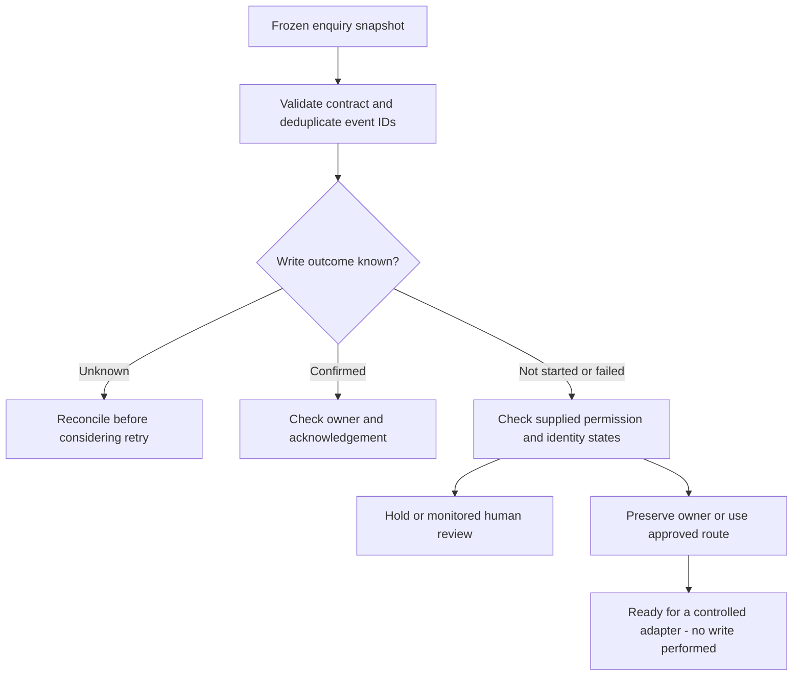

Akshay Shaligram — https://growth-marketing-consultant.com/

I built this companion to show what a lead-routing plan needs beyond a happy-path diagram: stable event references, explicit ownership and a safe response to uncertain writes. Original educational code, developed with AI assistance. All data are synthetic.

# Demo request → accountable owner

Run from the repository root with Node.js 20 or newer. No dependencies, API key, model calls or CRM account required.

```sh
node lead-routing/demo.mjs
node --test
```

The known-answer example has **7 input rows, 6 distinct events and 1 repeated export row**. Two events are ready for a controlled adapter; one needs reconciliation, one needs owner review, one is held and one is already confirmed and acknowledged. These are decisions over supplied evidence, not six new contacts or sales.



## Field contract

Every record must contain exactly these fields. Unexpected data are rejected so an accidental transcript or email field is not silently accepted.

| Field | Meaning / allowed values |
| --- | --- |
| `eventId` | Stable opaque enquiry reference, 1–80 letters, digits, hyphens or underscores. Not a person ID. |
| `replyBasis` | Organisation-supplied `approved`, `denied`, or `unknown`; never inferred from model text. |
| `identity` | `matched`, `new`, `ambiguous`, or `unknown`. Requires upstream evidence. |
| `writeState` | `not_started`, `unknown`, `confirmed`, or `failed`. Confirmation must come from the destination adapter. |
| `humanRequested` | Boolean; requests for a person require review before a new write. |
| `ownerId` | Existing opaque owner ID or `null`. Never silently overwritten by a fallback. |
| `routeOwnerId` | Owner chosen by approved routing policy, or `null`. This example does not calculate territory coverage. |
| `ownerAcknowledged` | Boolean; only valid with a confirmed write and an existing owner. |
| `source` | Observed `direct`, `organic`, `paid`, `referral`, or `unknown`. Retained without claiming causal attribution. |

```js
import { planHandoffs } from './lead-routing/route.mjs';
import { fixtures } from './lead-routing/fixtures.mjs';
const report = planHandoffs(fixtures);
console.log(report.counts.reconcile); // 1
```

## Important exceptions

- Same event and identical fields: collapse a repeated export row. Same event with different fields: fail the entire snapshot. This is not an event-stream processor; changing status requires a new reconciled snapshot.
- Unknown write: inspect the destination before retrying. Even a subsequently denied reply does not erase the need to reconcile a possibly completed write. Reconciliation is a read/review decision, not permission to send a reply.
- Confirmed write: inspect ownership and acknowledgement. It does not prove that a person replied, that the enquiry is qualified, or that permission for further marketing exists.
- Missing owner, ambiguous identity, failed write or human request: route to an accountable review process. A function returning `review` does not create or monitor that queue.
- The model is absent from the routing decision. Optional summarisation should be a separate, reviewed step and must not control identity, permission or delivery state.

## Before adapting this to real work

This is an in-memory teaching example, limited to 10,000 rows. It does not provide durable idempotency across requests, transactions, concurrent-worker safety, authentication, deletion, retention, identity resolution or a vendor API integration. A production adapter needs a durable unique event constraint, authenticated inputs, audited permissions, controlled writes, destination acknowledgements, bounded recovery and a monitored review queue. Confirm owner availability upstream. Do not log or publish customer data or secrets; opaque format validation alone does not anonymise an ID.

Freeze one reporting cohort, timezone and observation cutoff before supplying records. Report ready, unresolved, confirmed and acknowledged counts separately. Neither ready-for-adapter nor a 2xx response establishes a qualified lead. This example makes no performance or client-result claims.

Explore the [Marketing Workflow Architect walkthrough](https://growth-marketing-consultant.com/tools/marketing-workflow-architect?utm_source=github&utm_medium=referral&utm_campaign=workflow_architect_launch#lead-routing-walkthrough) to see the brief, field map and implementation checklist. The website's worked example also uses no AI calls; personalised generation has a separate limited allowance. See the [lead-agent handoff guide](https://growth-marketing-consultant.com/blog/ai-lead-agents-crm-handoff-qualification) for the broader design.

MIT licensed under the repository licence.
